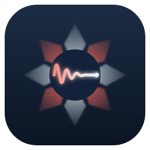
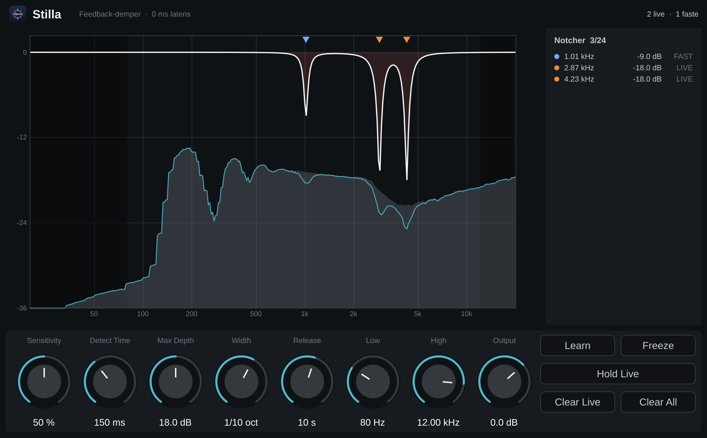

# Stilla

*English · [Norsk](README.no.md)*

Feedback suppressor for live sound in VST3 format (and AU on Mac). Stilla detects feedback automatically and places a narrow notch filter on exactly that frequency. Everything is IIR, so the plugin has **0 samples of latency**. Built with JUCE 9.0.5.



## How it works

Feedback is a pure tone that stays perfectly still in frequency and keeps building up. Voices and instruments have overtones, vibrato and changing levels. Stilla analyses the input with an FFT about every 10 ms and looks for peaks that:

1. stand well above the surrounding spectrum,
2. have no overtones or undertones,
3. stay on the same frequency (within ~6 Hz) without dropping in level for the whole **Detect Time**.

When all three are met, a 6 dB notch is set. If the feedback returns at the same spot, the notch gets 3 dB deeper each time, up to **Max Depth**. The depth fades in over about 5 ms and out over about 1.5 s, so notches come and go without clicks.

In a simulated feedback loop (see the tests), Stilla gives **5–8 dB more gain before feedback** and uses under 3 % CPU with all 24 notches active.

## Workflow

1. **Sound check:** turn on **Learn** and ring out the room by carefully raising the gain. Notches set now are **fixed** (blue) and stay put. They are saved with the project.
2. **Show:** turn off Learn. New feedback gets **live notches** (orange), which are released again after the **Release** time if the feedback does not return.
3. **Freeze** stops new notches, for example during a passage with a pure, sustained tone that should not be cut.

## Controls

| Control | What it does |
|---|---|
| **Sensitivity** (0–100 %) | How distinct a peak must be. Higher catches feedback earlier but gives more false hits. |
| **Detect Time** (50–1000 ms) | How long a tone must last before it counts as feedback. Shorter is faster, longer gives fewer false hits. |
| **Max Depth** (6–30 dB) | Deepest cut per notch. |
| **Width** (1/60–1/3 octave) | Width of each notch. Narrower affects the sound less. Default is 1/10 octave. |
| **Release** (1–60 s) | How long a live notch stays after the feedback is gone. |
| **Low / High** | The frequency range the detector listens to. The range outside is shaded in the spectrum. |
| **Output** | Output level. |
| **Learn** | New notches become fixed. |
| **Freeze** | No new notches. |
| **Hold Live** | Live notches are never released. |
| **Clear Live / Clear All** | Removes live notches, or all of them. |

## Display

- **Spectrum:** input in grey, output in blue, with a 4.5 dB/oct tilt.
- **White curve:** combined response of all notches (0 to −36 dB).
- **Triangles at the top:** one per notch, orange for live and blue for fixed.
- **List on the right:** all active notches with frequency, depth and type.

## Limitations

- A perfectly pure, sustained tone without vibrato (flute, synth, sine wave) looks like feedback and may get a notch. Use **Freeze**, or set **Low/High** to exclude the tone.
- Stilla suppresses feedback with notches. It does not remove reverb or background noise the way AI-based tools with higher latency do.

## Building

### Via GitHub (recommended)
The workflow in `.github/workflows/build-macos.yml` builds VST3 and AU as a universal binary (Apple Silicon and Intel), runs the DSP tests and pluginval, and creates a `.pkg` installer. Finished versions are under **Releases**. A new release is created automatically when `VERSION` in `CMakeLists.txt` is increased and pushed to `main`.

### Locally on Mac
```bash
cmake -B build -G Xcode
cmake --build build --config Release --target Stilla_VST3 Stilla_AU
```
Copy `Stilla.vst3` to `~/Library/Audio/Plug-Ins/VST3/` and `Stilla.component` to `~/Library/Audio/Plug-Ins/Components/`.

## Tests
`cmake -B build -DSTILLA_BUILD_TESTS=ON`, then:
- `DspTest`: the notch filter, transparency, detection of a growing tone, false hits on noise, singing and speech, Learn/Release/Freeze, a simulated feedback loop in three rooms, and CPU.
- `HostTest <plugin.vst3> <image.png>`: loads the actual VST3 file, tests 44.1/48/96 kHz and blocks of 32–1024 samples, random automation, state with fixed notches, bypass and latency.
- `GuiSnapshot <image.png>`: draws the GUI with a few notches.

## Code structure
| File | Contents |
|---|---|
| `Source/dsp/HowlDetector.h` | Finds feedback: FFT, spectral criteria and tracking over time. |
| `Source/dsp/NotchBank.h` | The 24 notches: live and fixed, deeper on repeat, release. |
| `Source/dsp/NotchFilter.h` | The notch filter itself (SVF) and the exact response for the GUI curve. |
| `Source/dsp/FeedbackSuppressor.h` | Connects the detector and the notches. |
| `Source/dsp/Fft.h` | Small allocation-free FFT. |
| `Source/PluginProcessor.*` | Parameters, saving fixed notches, host integration. |
| `Source/PluginEditor.*` | Spectrum, notch list and controls. |

The DSP code in `Source/dsp/` has no JUCE dependency and can be tested on its own.

## License
JUCE is licensed under AGPLv3 or a commercial license. For private use this is not a problem. If the plugin is shared or sold as closed source, a commercial JUCE license may be required.
