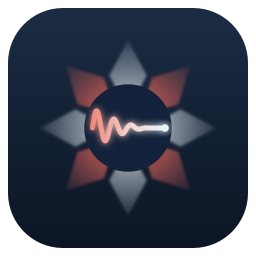
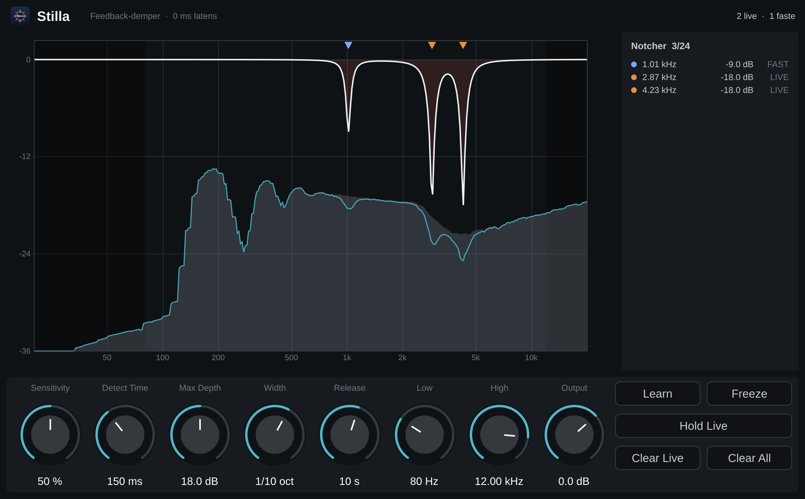

# Stilla

*[English](README.md) · Norsk*

Feedback-demper for live lyd i VST3-format (og AU på Mac). Stilla finner feedback automatisk og setter et smalt kutt-filter på akkurat den frekvensen. Alt er IIR, så pluginen har **0 samples latens**. Bygget med JUCE 9.0.5.



## Slik fungerer det

Feedback er en ren tone som står helt stille i frekvens og bygger seg opp. Stemmer og instrumenter har overtoner, vibrato og varierende nivå. Stilla analyserer inngangen med FFT hvert ~10 ms og ser etter topper som:

1. stikker langt opp over spekteret rundt seg,
2. mangler overtoner og undertoner,
3. står på samme frekvens (innenfor ~6 Hz) uten å falle i nivå i hele **Detect Time**.

Når alle tre er oppfylt, settes en notch på 6 dB. Kommer feedbacken tilbake på samme sted, blir notchen 3 dB dypere hver gang, opptil **Max Depth**. Dybden glir inn på ca. 5 ms og ut på ca. 1,5 s, så notcher kommer og går uten klikk.

I en simulert feedback-sløyfe (testene) gir Stilla **5–8 dB mer gain før feedback** og bruker under 3 % CPU med alle 24 notcher aktive.

## Arbeidsflyt

1. **Lydsjekk:** slå på **Learn** og ring ut rommet ved å skru opp gain forsiktig. Notchene som settes nå er **faste** (blå) og blir stående. De lagres i prosjektet.
2. **Konsert:** slå av Learn. Ny feedback får **live-notcher** (oransje), som slippes igjen etter **Release**-tiden hvis feedbacken ikke kommer tilbake.
3. **Freeze** stopper nye notcher, for eksempel under et parti med en ren, liggende tone som ikke skal kuttes.

## Kontroller

| Kontroll | Hva den gjør |
|---|---|
| **Sensitivity** (0–100 %) | Hvor tydelig toppen må være. Høyere fanger feedback tidligere, men gir flere feiltreff. |
| **Detect Time** (50–1000 ms) | Hvor lenge en tone må stå før den regnes som feedback. Kortere er raskere, lengre gir færre feiltreff. |
| **Max Depth** (6–30 dB) | Dypeste kutt per notch. |
| **Width** (1/60–1/3 oktav) | Bredden på hver notch. Smalere påvirker lyden mindre. Standard er 1/10 oktav. |
| **Release** (1–60 s) | Hvor lenge en live-notch står etter at feedbacken er borte. |
| **Low / High** | Frekvensområdet detektoren lytter på. Området utenfor er skyggelagt i spekteret. |
| **Output** | Utgangsnivå. |
| **Learn** | Nye notcher blir faste. |
| **Freeze** | Ingen nye notcher. |
| **Hold Live** | Live-notcher slippes aldri. |
| **Clear Live / Clear All** | Sletter live-notcher, eller alle. |

## Visning

- **Spekter:** inngangen i grått, utgangen i blått, med 4,5 dB/okt helning.
- **Hvit kurve:** samlet respons for alle notcher (0 til -36 dB).
- **Trekanter øverst:** én per notch, oransje for live og blå for faste.
- **Liste til høyre:** alle aktive notcher med frekvens, dybde og type.

## Begrensninger

- En helt ren, liggende tone uten vibrato (fløyte, synth, sinustone) ligner feedback og kan få en notch. Bruk **Freeze**, eller sett **Low/High** utenom tonen.
- Stilla demper feedback med notcher. Den fjerner ikke romklang eller bakgrunnsstøy, slik AI-baserte verktøy med høyere latens gjør.

## Bygging

### Via GitHub (anbefalt)
Workflowen i `.github/workflows/build-macos.yml` bygger VST3 og AU som universal binary (Apple Silicon og Intel), kjører DSP-testene og pluginval, og lager en `.pkg`-installer. Ferdige versjoner ligger under **Releases**. En ny release lages automatisk når `VERSION` i `CMakeLists.txt` økes og pushes til `main`.

### Lokalt på Mac
```bash
cmake -B build -G Xcode
cmake --build build --config Release --target Stilla_VST3 Stilla_AU
```
Kopier `Stilla.vst3` til `~/Library/Audio/Plug-Ins/VST3/` og `Stilla.component` til `~/Library/Audio/Plug-Ins/Components/`.

## Tester
`cmake -B build -DSTILLA_BUILD_TESTS=ON`, deretter:
- `DspTest`: notch-filteret, transparens, deteksjon av voksende tone, feiltreff på støy, sang og tale, Learn/Release/Freeze, en simulert feedback-sløyfe i tre rom og CPU.
- `HostTest <plugin.vst3> <bilde.png>`: laster selve VST3-fila, tester 44,1/48/96 kHz og blokker på 32–1024 samples, tilfeldig automasjon, state med faste notcher, bypass og latens.
- `GuiSnapshot <bilde.png>`: tegner GUI-et med noen notcher.

## Kodestruktur
| Fil | Innhold |
|---|---|
| `Source/dsp/HowlDetector.h` | Finner feedback: FFT, spektrale krav og sporing over tid. |
| `Source/dsp/NotchBank.h` | De 24 notchene: live og faste, dypere ved gjentakelse, release. |
| `Source/dsp/NotchFilter.h` | Selve kutt-filteret (SVF) og den eksakte responsen til GUI-kurven. |
| `Source/dsp/FeedbackSuppressor.h` | Kobler detektor og notcher sammen. |
| `Source/dsp/Fft.h` | Liten FFT uten allokering. |
| `Source/PluginProcessor.*` | Parametere, lagring av faste notcher, kobling mot verten. |
| `Source/PluginEditor.*` | Spekter, notch-liste og kontroller. |

DSP-koden i `Source/dsp/` har ingen JUCE-avhengighet og kan testes for seg.

## Lisens
JUCE er lisensiert under AGPLv3 eller kommersiell lisens. For privat bruk er det uproblematisk. Skal pluginen deles eller selges som lukket kode, kan det kreves en kommersiell JUCE-lisens.
